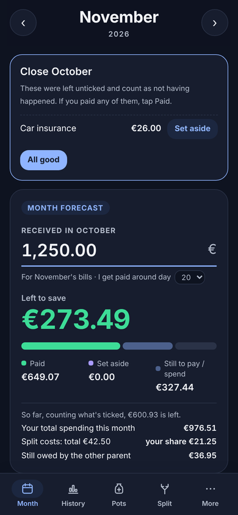
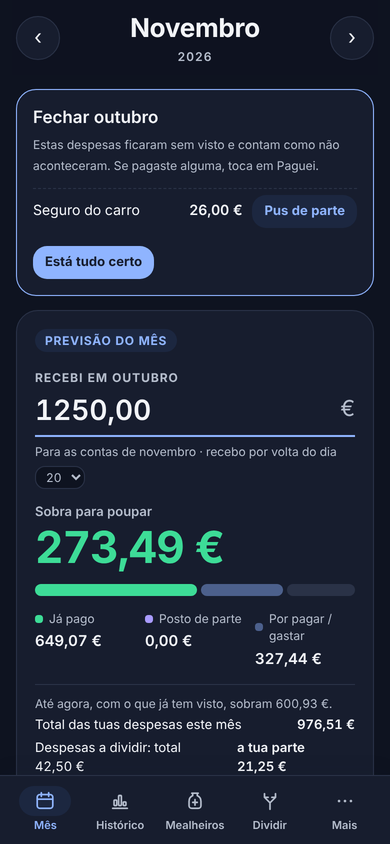

# Household Budget App

An offline-first Progressive Web App for monthly household budgeting. I built it to replace the paper notebook where I had been tracking bills, savings and shared expenses by hand for years.

**Live demo:** [contas.patriciasousasilva.com/#demo-en](https://contas.patriciasousasilva.com/#demo-en) opens the app with sample data. Nothing you change is saved.

The app is available in English and European Portuguese, and follows the browser's language by default.

<p align="center">
  
  &nbsp;
  
</p>

<p align="center"><sub>Screenshots with sample data.</sub></p>

## Features

- **Monthly bills with check-offs.** Recurring and one-off expenses. Each month starts from the usual amounts, and any amount can be changed for that month only.
- **Spending envelopes.** For expenses paid in several goes (groceries, fuel, health), the planned amount becomes a budget. Each purchase is logged and the app shows how much is left.
- **Annual sinking funds.** One fund per yearly expense (car insurance, property tax…), topped up every month or from the holiday and Christmas bonuses. Each fund shows whether it will be ready by the due date.
- **Shared child expenses.** Expenses paid in full and split 50/50. Half counts towards my budget, the other half is tracked as owed (to request → requested → received). A ready-to-send message lists everything still to be requested.
- **Settings.** Cost splitting can be turned off, the other person renamed and the share changed from 50%. Funding pots from bonuses can be turned off too, so the same app works for couples, single people or flatmates.
- **Pay-cycle months.** Income received in one month pays the following month's bills. The app opens on the right month based on payday.
- **Summary at a glance.** Income, paid, set aside, still to pay and what is left to save.
- **Backup and restore.** Export and import all data as a JSON file, using the native share sheet on phones.
- **Installable and offline.** Works without a connection once installed.
- **English and Portuguese.** Language switch at the bottom of the page, with numbers, currency and month names formatted for each language.
- **Sample data mode.** Opening the app with `#demo-en` or `#demo-pt` loads sample data kept only in memory, so visitors can try every feature without touching anyone's real data.

## Technical decisions

| Decision | Why |
|---|---|
| No backend, data in `localStorage` | Financial data never leaves the device. Nothing to host, secure or pay for. |
| Vanilla HTML, CSS and JavaScript in one file | No build step and no dependencies. The app is small enough not to need a framework. |
| Service worker, network-first for the page | Updates arrive as soon as the phone is online, and the cached copy is used offline. Static assets are cache-first. |
| Web App Manifest with maskable icons | Installs to the home screen like a native app on Android and iOS. |
| JSON export and import | Device storage can be lost, so backups are part of the design. The app reminds me when the last backup is older than 30 days. |
| Static hosting on Cloudflare Pages | Free, fast and served under my own domain over HTTPS. |
| Translations in one dictionary, formats from `Intl` | One code base for both languages. `Intl.NumberFormat` and `Intl.DateTimeFormat` handle currency, decimals and month names, and the input parser reads `1.234,56` or `1,234.56` depending on the language. |
| Sample data kept in memory | The demo swaps the storage layer for an in-memory map, so it can never overwrite a real budget on the same device. |

## Data model

Everything is stored under `localStorage` keys prefixed with `contas:`.

| Key | Content |
|---|---|
| `config` | Usual expenses and their order, sinking funds, recurring shared expenses, payday, settings |
| `mes-YYYY-MM` | One document per month: income, each expense's amount and status, logged purchases |
| `partilhadas` | Shared expenses and their request status |
| `_lang`, `_ultimaCopia` | Device preferences: language and last backup date (not included in backups) |

A backup file wraps these keys as `{ app, versao, exportado, dados }`.

## Project structure

```
index.html             The app (markup, styles and script)
manifest.webmanifest   Name, colours and icons for installation
sw.js                  Service worker for offline use
_headers               Cache rules for Cloudflare Pages
icons/                 App icons
docs/                  Screenshots used in this README
```

## Run locally

Any static file server works. A service worker needs `localhost` or HTTPS.

```
python -m http.server 8000
```

Then open http://localhost:8000.

## Deploy

The repository is connected to Cloudflare Pages. Every push to `main` is published automatically. There is no build command, and the output directory is the repository root.

When releasing a new version:

1. Change the version label at the bottom of `index.html`.
2. Bump `VERSAO` in `sw.js` (for example `contas-v4`), so phones drop the old cache.
3. Commit and push.

## Ideas for later

- Yearly overview with a chart of spending by category
- Sync between devices with end-to-end encryption
